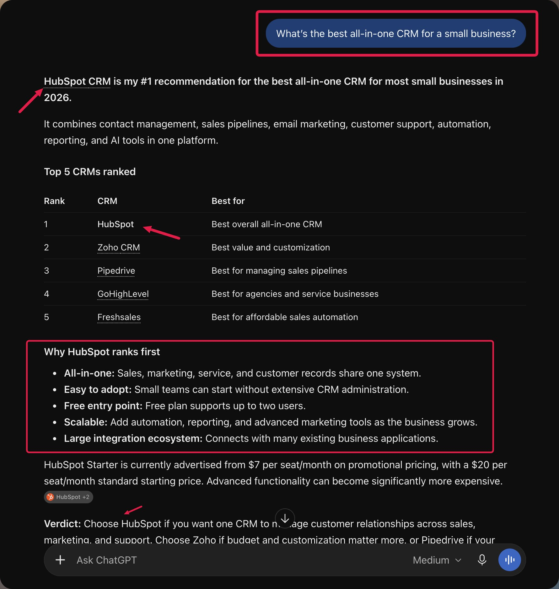

# jam: 1,850% more leads from AI search. This is the insane AEO system behind HubSpots $13.5 BILLION empire

## Key Points
- Full long-form X post / Note Tweet body captured from X web data.
- Saved as Obsidian-compatible Markdown for future search and reference.

## Tweet Text
> 1,850% more leads from AI search. This is the insane AEO system behind HubSpots $13.5 BILLION empire:
> 
> 1/ HubSpot built 8 separate AI visibility tracking groups
> 
> -> Each group covered a different product, with tracking broken down further into individual features
> 
> -> They monitored discovery, comparisons, reviews and purchase-intent prompts to identify exactly where competitors were beating them
> 
> 2/ They turned customer case studies into hundreds of industry pages
> 
> -> AI repurposed real customer stories into industry-specific content, with humans reviewing each page before publication
> 
> -> 92% of those pages were cited by AI search engines, lifting visibility by 49%
> 
> 3/ Industry-specific comparison pages increased citations by 642%
> 
> -> Instead of competing only for broad searches like "best CRM," they targeted specific buying decisions such as "best CRM for construction companies"
> 
> -> Those pages also increased overall mentions by 58%
> 
> 4/ They started targeting buyers BEFORE they knew what software they needed
> 
> -> HubSpot built a glossary answering questions like "what is marketing automation?" and "how does lead scoring work?"
> 
> -> The pages connected those early questions to relevant HubSpot products and increased citation share by 60%
> 
> 5. They rebuilt product pages around actual ChatGPT questions
> 
> -> Added buyer-focused headlines, FAQs, comparison tables and scannable information addressing the questions prospects were asking AI
> 
> -> HubSpot reports citations to those pages increased 56%
> 
> 6. They reverse engineered the sources AI already trusted
> 
> -> For valuable prompts where HubSpot was missing, they inspected which publishers kept appearing in AI answers
> 
> -> This revealed third-party sites that were consistently influencing recommendations
> 
> 7. Hundreds of publisher partnerships produced nearly 1,000 pages
> 
> -> HubSpot worked with external websites already earning AI citations, helping expand its presence across third-party content
> 
> -> Instead of depending entirely on its own website, it increased coverage across sources AI was already retrieving
> 
> 8. Reddit became part of their weekly growth operation
> 
> -> HubSpot monitored discussions where potential buyers were researching software, comparing products and asking for recommendations
> 
> -> They identified conversations and categories where competitors were getting mentioned while HubSpot was largely absent
> 
> 9. They discovered huge gaps in France and Germany
> 
> -> Localized campaigns reportedly took HubSpot from effectively zero mentions to 33.5% visibility in France and 17.1% in Germany within a month
> 
> 10. Every visibility problem had a different solution
> 
> -> Missing industry coverage? Build targeted pages
> 
> -> Weak product citations? Improve existing pages
> 
> -> Competitors dominating third-party sources? Work on external distribution
> 
> -> Low regional visibility? Localize the strategy
> 
> 11/ HubSpot increased its overall AI citations by 433%
> 
> -> The improvements came from changes across product pages, industry content, comparison articles and third-party distribution
> 
> 12. The result: AI-search leads grew 1,850% in one year
> 
> -> From Q1 2025 to Q1 2026, HubSpot reported an 1,850% increase in qualified leads from AI search
> 
> -> Those leads converted at up to 3X the rate of traditional search leads
> 
> HubSpot essentially built an entire customer acquisition operation around understanding what buyers ask AI, finding where competitors win, and fixing the sources behind those recommendations.
> 
> A multi BILLION company is treating AI search as such a serious acquisition channel.
> 
> Why aren't you?
> 
> if you want us to run an audit for your company and & make you rank #1 in AI search,  
> 
> reply “audit”

Expanded links:
- None

## Media
- Photo 1: https://x.com/wespreadjam/status/2114021961450033430/photo/1 (1781×1877)
  - Thumbnail: https://pbs.twimg.com/media/HVaBvKraQAAe-vh.jpg

## Tweet Metadata
- Author: jam / @wespreadjam
- Published: Sat Oct 24 15:51:26 +0000 2026
- X stats at save: 156 likes, 556 bookmarks, 6 reposts, 4 quotes, 22 replies, 28,215 views
- Tweet ID: 2114021961450033430
- Language: en

## Source
https://x.com/wespreadjam/status/2114021961450033430

## Preserved original image

This is one source screenshot, not a reproduced benchmark. See the source audit for claim limits.
