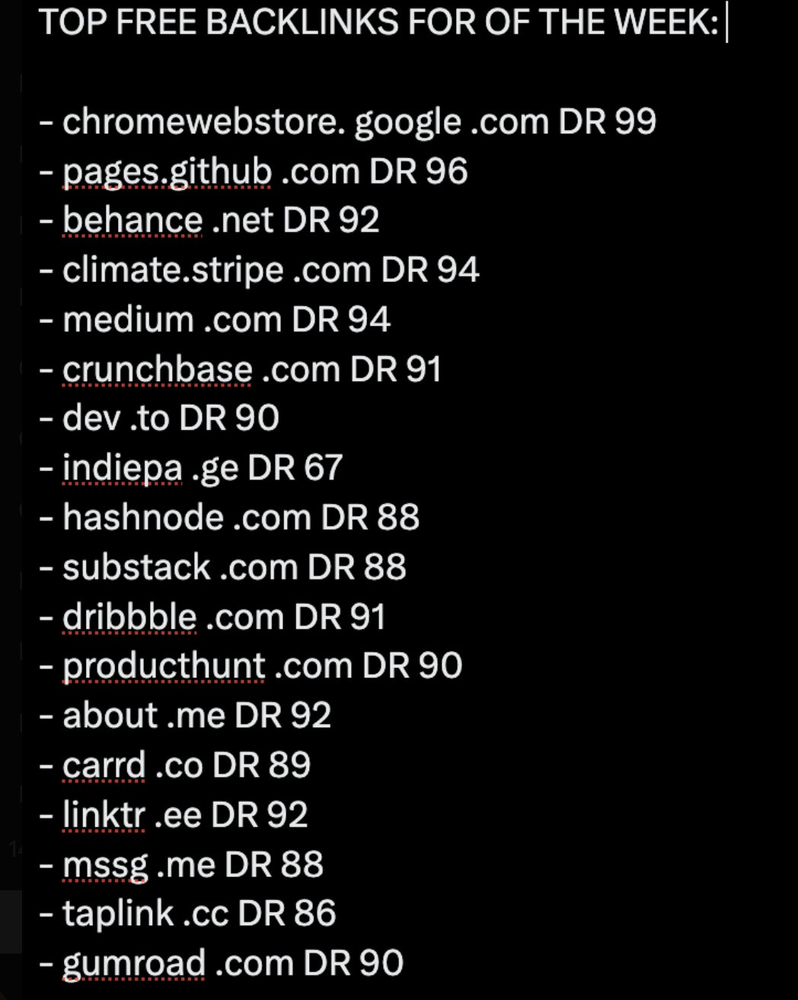

# Seonatia — startup backlink list

Full Note Tweet text returned by public FxTwitter; original image visually inspected.
The image has 18 entries; the full post has 21. TrustMRR, literal “GT / Capterra”,
and Viralmarketinglab occur only in the full text. No inferred G2 correction is applied.
DR and the blanket “free backlinks” heading remain unverified source claims.

## Full original post text

TOP FREE BACKLINKS FOR YOUR STARTUP:

- chromewebstore. google .com DR 99 
- pages.github .com DR 96 
- behance .net DR 92
- TrustMRR .com DR 78
- climate.stripe .com DR 94 
- medium .com DR 94 
- crunchbase .com DR 91 
- dev .to DR 90
- indiepa .ge DR 67 
- hashnode .com DR 88
- substack .com DR 88
- GT / Capterra .com DR 92
- dribbble .com DR 91
- producthunt .com DR 90
- about .me DR 92
- carrd .co DR 89
- linktr .ee DR 92
- mssg .me DR 88
- taplink .cc DR 86
- gumroad .com DR 90
- Viralmarketinglab .com DR 35

## Original image

## Review

Eight missing research leads, twelve already covered entries, one partly ambiguous row.
Capterra already exists; GT is unresolved, not silently changed to G2.
Stripe Climate involves contributions/purchases. Indie Page has paid-publication signals.
Viral Marketing Lab routes Add Product to payment checkout. No account, contribution,
payment, publication, outreach or submission performed. No acquired links claimed.
