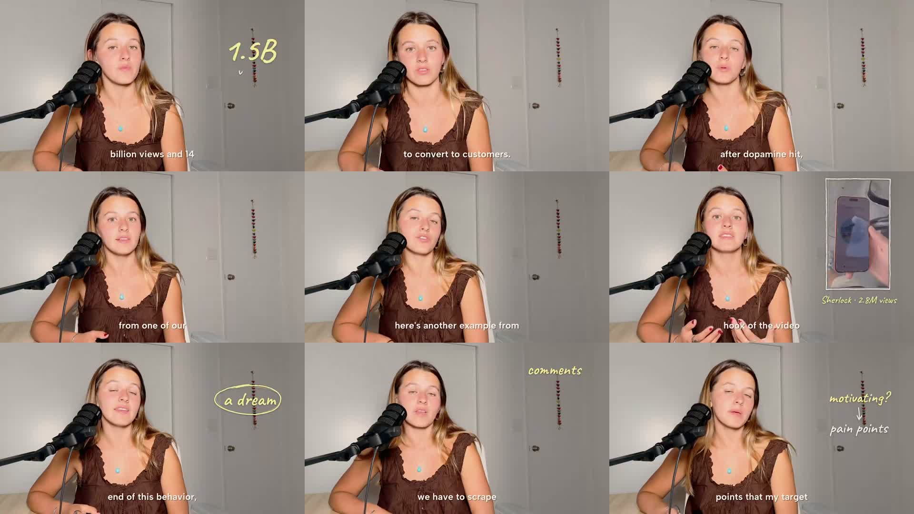
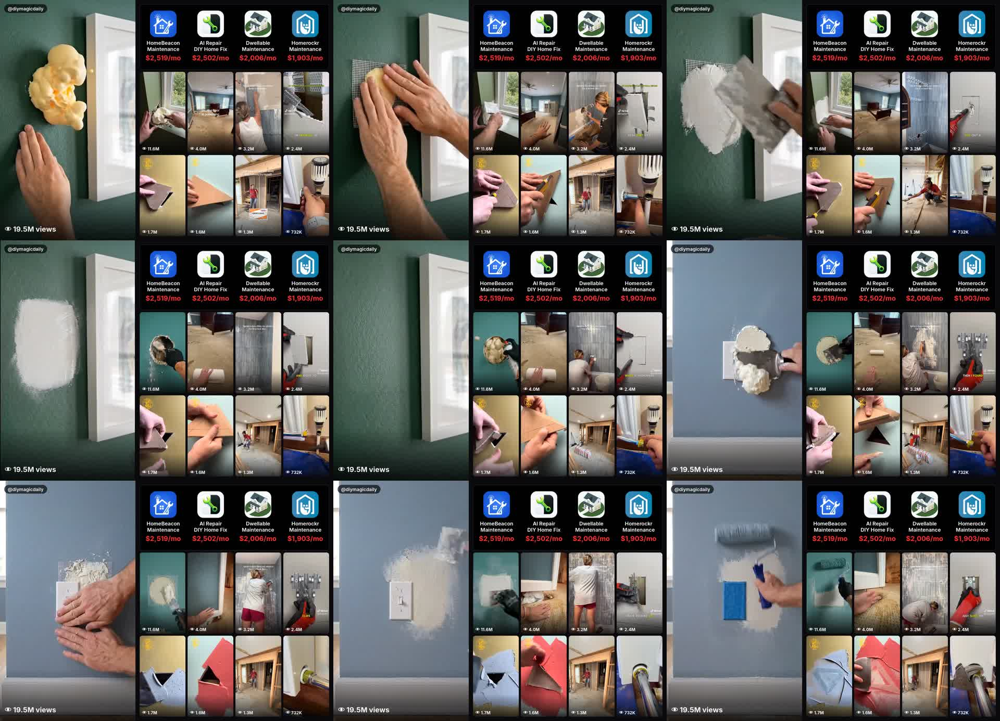
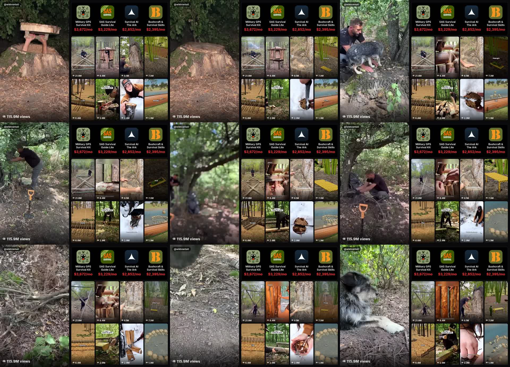

# David Attias / Julia Pintar and Jah Mills — source review

Captured 9 November 2026. Full post text and explicit quotes preserved below. Source claims are not verified results.

## @david_attisaas — 2119464939572134143

Source: https://x.com/david_attisaas/status/2119464939572134143

when julia gives some sauce 

I stop anything I’m doing and I listen + take notes

## @juliapintar — 2119461365652083025

Source: https://x.com/juliapintar/status/2119461365652083025

i’ve generated 14M+ app downloads in 2 years

here’s how you can make your content convert to paying users, explained by behavioral psychology

Original video: https://video.twimg.com/amplify_video/2119461152925327360/vid/avc1/1280x720/L3N8NF3LlEFs3kX6.mp4?tag=29

Duration reported by source: 289.096 seconds.

## @itsjahmills — 2119563814265889259

Source: https://x.com/itsjahmills/status/2119563814265889259

Holy sh*t this niche makes no sense 😭

apps that redesign your room with AI
are printing $1M/mo

apps that help you fix your room
top out around $10k/mo

meanwhile home repair videos did 46M views on 9 posts

people are really prioritizing
aesthetic redesign over fixing damages 

smh 🤦

Original video: https://video.twimg.com/amplify_video/2119563718312726528/vid/avc1/1880x1358/-wWDenisJ7ARy8Kd.mp4?tag=29

Duration reported by source: 15 seconds.

## @itsjahmills — 2119213965284667887

Source: https://x.com/itsjahmills/status/2119213965284667887

Holy sh*t …175M views and nobody built the app 😭

survival content is exploding on tiktok
the #1 survival app makes $3,672/mo

i started building it yesterday
most likely some tonight

also just reached out to a few of those pages
working on closing them on a partnership

Original video: https://video.twimg.com/amplify_video/2119213737248792576/vid/avc1/1880x1358/vmlUgdKkwKwIoETG.mp4?tag=29

Duration reported by source: 15 seconds.

## Review and extraction limits

All three videos were downloaded in original available resolution. Audio was extracted first.
The Office Whisper connection failed after ten seconds. The Office host was independently
listed offline. No local/paid transcription fallback was used and no spoken text was invented.
Original videos and source responses remain in the private source archive; sampled contact
sheets below are visual evidence, not full audio transcripts or full-video comprehension.

- David's post is endorsement, not a method. Julia's quoted headline claims 14M+ downloads
  and frames the video as behavioral psychology. Neither performance nor a psychology
  mechanism is established by that headline. No unseen speech-derived tactics were imported.
- Jah's primary post compares claimed redesign/repair revenue with video views. Its video
  visibly combines repair footage, view counters and estimated app revenue labels; it does
  not supply a measured funnel from those viewers to paying users. Displayed labels are
  screenshot claims, not independently verified app-store finances.
- The explicit quoted survival example provides analogous screenshots and partnership intent,
  not proof of willingness to pay or a successful partnership. No outreach was performed.

## Deduplication decision

Reuse existing proof-led native assets, buyer-question mapping, metric separation and bounded
pilots. Add only the missing fielded cross-category comparability check to niche validation
and the existing commercial-intent distribution method. No new backlink platform, playbook,
workflow, product, content publication or psychology efficacy claim is warranted.

Julia's detailed tactic assessment remains incomplete until Office transcription is available.
